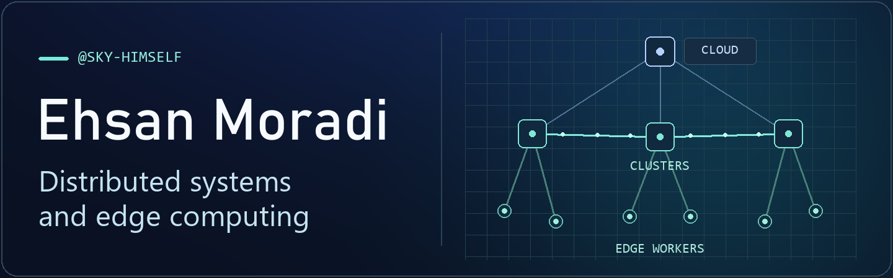
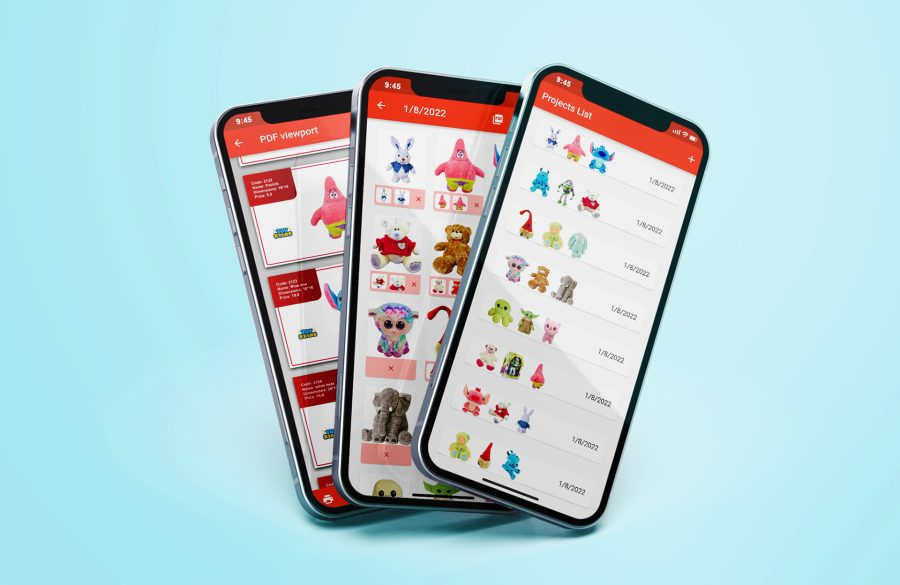
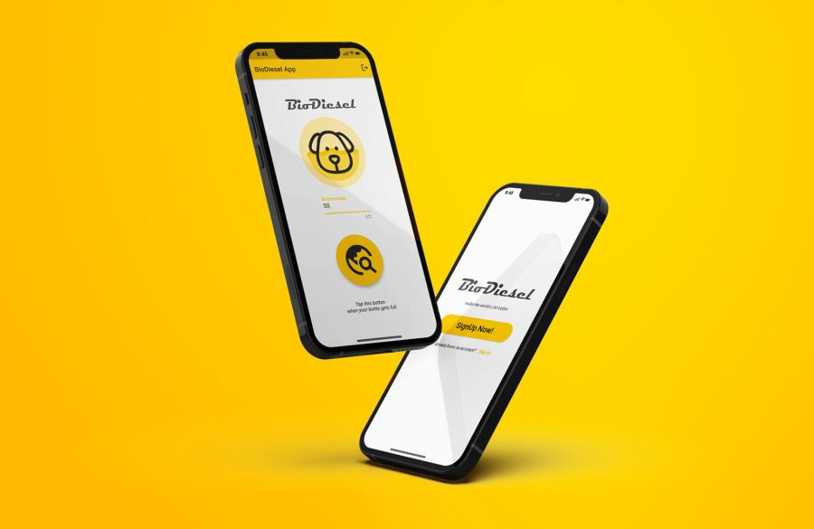

  

  <a href="#research">Research</a> &nbsp;·&nbsp;
  <a href="#projects">Projects</a> &nbsp;·&nbsp;
  <a href="https://github.com/Sky-himself/Sky-himself.github.io">Portfolio source</a> &nbsp;·&nbsp;
  <a href="https://www.linkedin.com/in/its-ehsan-moradi/">LinkedIn</a>

I’m Ehsan. I work on distributed systems and edge computing. My M.Sc. research at Amirkabir University of Technology asks what happens when an overloaded edge cluster can borrow capacity from its neighbors.

## Research

### [Scaling Beyond Home](https://github.com/Sky-himself/vicinity-aware-autoscaling)

**Can nearby edge clusters absorb a traffic spike before requests need to go to the cloud?** I built a simulator and autoscaling policies to study that question. The Python implementation combines demand forecasting, local scaling, and resource sharing, with experiment scripts for comparing the policies.

[Explore the implementation →](https://github.com/Sky-himself/vicinity-aware-autoscaling) &nbsp;·&nbsp; [Run the experiments →](https://github.com/Sky-himself/vicinity-aware-autoscaling/blob/main/docs/EXPERIMENTS.md)

For the simulation environment on its own, see [HierarchicalEdgeSim at ECTLab](https://github.com/ECTLab/HierarchicalEdgeSim). The [Docker Compose prototype](https://github.com/Sky-himself/edge_computing_thesis) shows the same three layers as separate services.

## Projects

<table>
  <tr>
    <td width="50%" valign="top">
      
      
<strong><a href="https://github.com/Sky-himself/catalogue_maker">Catalogue Maker</a></strong>

      
Go from product photos and details to a PDF catalogue. Built with Flutter and SQLite.

    </td>
    <td width="50%" valign="top">
      
      
<strong><a href="https://github.com/Sky-himself/organic_gasoline_app">Biodiesel Prototype</a></strong>

      
A Flutter interface for a used-cooking-oil collection concept, with custom animations and forms.

    </td>
  </tr>
</table>

I also built [Personal Dictionary](https://github.com/Sky-himself/personal-dictionary) to turn saved translations into flashcards and track which words I’ve learned.

[Browse all public repositories →](https://github.com/Sky-himself?tab=repositories)
